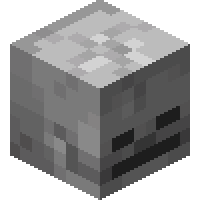

<h1>
  
  DropHeads
</h1>

[Русский](README.md) | **English**

A Minecraft plugin that adds head drops from mobs and players.

## Features

- Head drops from mobs and players killed by a player.
- Heads for different mob variants, including rare trophies.
- Configurable drop chances. Looting increases the chance of mob head drops.
- Names set in the configuration are preserved after placing and breaking heads.

## Version and requirements

| Plugin version | Target server | Java |
| --- | --- | --- |
| 1.2.11 | Paper for Minecraft 1.21.7 | 21 |

## Installation

1. Install JDK 21 and Maven, then run `mvn clean package` from the project directory.
2. Copy `target/DropHeads-1.2.11.jar` to your server's `plugins` directory.
3. Restart the server. The plugin creates `plugins/DropHeads/config.yml` on first startup.

## Configuration

Edit `plugins/DropHeads/config.yml` to adjust drop chances, the Looting multiplier, head textures, head names, and messages.

Drop chances are expressed as decimals: `0.05` means **5%**. Restart the server after editing the configuration.

Default head names and messages are in Russian.

## Command

```text
/gethead <head_tag>
```

Gives you a mob head defined in the configuration. The command is available only to server operators and must be run in-game.

Use the texture key without the `_head_texture` suffix as the tag. For example, for `pig_head_texture`, use:

```text
/gethead pig
```
